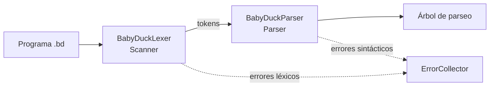

# Compilador BabyDuck

**Autor(a):** Maria Quetzalli Ramirez Martinez · **Matrícula:** A01753959
**Materia:** Desarrollo de aplicaciones avanzadas de ciencias computacionales · **Profesor(a):** [Nombre]

## Índice

1. **Overview** (este capítulo)
2. [Herramientas](02_herramientas.md)
3. [Análisis léxico](03_lexico.md)
4. [Análisis sintáctico](04_sintaxis.md)
5. [Análisis semántico](05_semantica.md)
6. [Código intermedio](06_codigo_intermedio.md)
7. [Testing](07_testing.md)
8. [Herramientas de IA](08_herramientas_ia.md)
9. [Guía de uso](09_guia_de_uso.md)

---

## Descripción

Este proyecto implementa un compilador para **BabyDuck**, un mini-lenguaje imperativo con variables enteras y flotantes, funciones con parámetros, condiciones, ciclos y entrada/salida.

El compilador se desarrolla en **Java** y usa **ANTLR4** para generar automáticamente el analizador léxico (Scanner) y el analizador sintáctico (Parser) a partir de un archivo de gramática.

## Tecnologías

| Elemento                         | Versión / Herramienta           |
| -------------------------------- | ------------------------------- |
| Lenguaje de desarrollo           | Java 25 (LTS)                   |
| Generador de Scanner y Parser    | ANTLR 4.13.2                    |
| Gestor de proyecto y compilación | Maven                           |
| Pruebas automáticas              | JUnit 5                         |
| IDE                              | IntelliJ IDEA + plugin ANTLR v4 |

## Flujo del compilador (estado actual)



## Estructura del proyecto

```
compilador/
├── pom.xml                                  Configuración de Maven y ANTLR
├── docs/                                    Esta documentación
└── src/
    ├── main/
    │   ├── antlr4/com/babyduck/BabyDuck.g4  Gramática: tokens + reglas
    │   └── java/com/babyduck/
    │       ├── Main.java                    Punto de entrada
    │       ├── BabyDuckAnalyzer.java        Ejecuta lexer + parser
    │       └── ErrorCollector.java          Recolecta errores léxicos y sintácticos
    └── test/
        ├── java/com/babyduck/
        │   ├── LexerTest.java               Pruebas del Scanner
        │   └── ParserTest.java              Pruebas del Parser
        └── resources/syntax/
            ├── valid/                       Programas que deben aceptarse
            └── invalid/                     Programas que deben rechazarse
```

Las clases `BabyDuckLexer`, `BabyDuckParser`, `BabyDuckListener` y `BabyDuckVisitor` **no se escriben a mano**: el plugin de Maven las genera desde `BabyDuck.g4` en cada compilación, dentro de `target/generated-sources/antlr4/`.

## Compilación y ejecución

```bash
mvn compile                 # genera el Scanner/Parser y compila
mvn test                    # ejecuta el Test-Plan (JUnit)
```

Para analizar un programa (en IntelliJ, como _Program arguments_ de `Main`):

```
<archivo.bd> [--tokens]
```

- Sin `--tokens`: indica si el programa es válido e imprime el árbol de parseo, o lista los errores.
- Con `--tokens`: además imprime la lista de tokens reconocidos.

## Avance por entrega

| Entrega | Contenido                                                         | Estado    |
| ------- | ----------------------------------------------------------------- | --------- |
| 1       | Expresiones regulares, tokens y gramática libre de contexto (CFG) | ✓         |
| 2       | Selección de herramienta, Scanner, Parser y Test-Plan             | ✓         |
| 3       | Análisis semántico                                                | Pendiente |

---

## Navegación

- Siguiente: [Herramientas →](02_herramientas.md)
