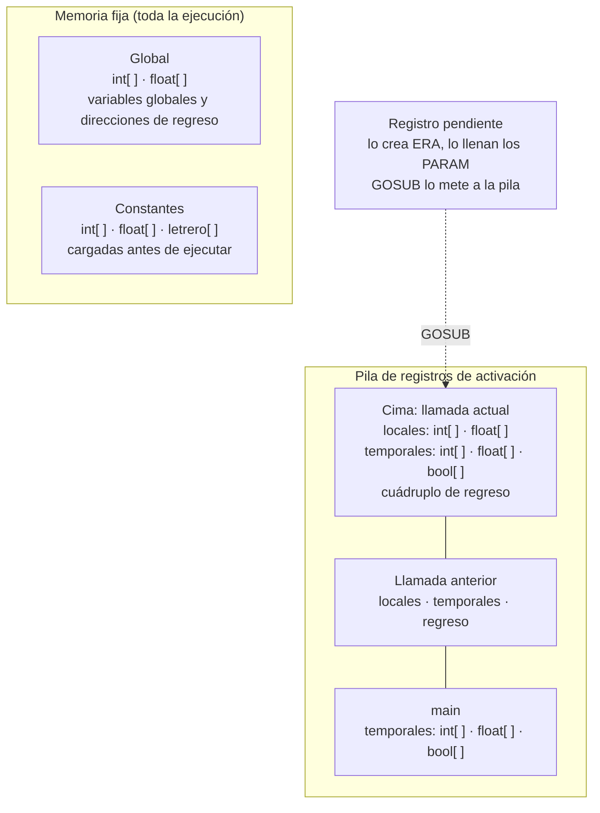

# Máquina virtual

## Índice

1. [Overview](01_overview.md)
2. [Herramientas](02_herramientas.md)
3. [Análisis léxico](03_lexico.md)
4. [Análisis sintáctico](04_sintaxis.md)
5. [Análisis semántico](05_semantica.md)
6. [Código intermedio](06_codigo_intermedio.md)
7. [Memoria virtual](07_memoria_virtual.md)
8. **Máquina virtual** (este capítulo)
9. [Testing](09_testing.md)
10. [Herramientas de IA](10_herramientas_ia.md)
11. [Guía de uso](11_guia_de_uso.md)

---

## Qué hace

La máquina virtual ejecuta la fila de cuádruplos. Todo pasa en una sola corrida: se compila el
programa y, si no hay errores, `Main` crea la máquina con lo que ya está en memoria y la ejecuta.
No se escribe un archivo intermedio.

La máquina solo recibe números: los **códigos de operación**, las **direcciones** de los operandos,
la **tabla de constantes** y, del directorio de funciones, los **tamaños** y los **inicios**. Nunca
consulta nombres de variables ni tablas de símbolos. Por eso la fila con direcciones también lleva
números en los operandos que no son memoria: `ERA` y `GOSUB` llevan el inicio de la función,
`PARAM` la dirección local del parámetro y los saltos el número de cuádruplo.

| Clase | Paquete | Qué hace |
|---|---|---|
| `VirtualMachine` | `vm` | Carga el programa y ejecuta el ciclo de cuádruplos (unidad de ejecución y control, entrada y salida) |
| `ExecutionMemory` | `vm` | Administrador de memoria: traduce una dirección a su casilla; pila de llamadas |
| `ActivationRecord` | `vm` | Memoria de una llamada: locales, temporales y cuádruplo de regreso |
| `MemoryBlock` | `vm` | Casillas de un segmento: un arreglo por tipo y una marca de casillas con valor |
| `RuntimeError` | `vm` | Error del programa durante la ejecución |
| `VirtualMemory` | `intermediate` | Tabla de rangos: dirección → segmento, tipo y casilla (la misma que usa el compilador) |

## Carga

Al crear la máquina se prepara todo antes del primer cuádruplo:

1. **Memoria global:** un bloque del tamaño del segmento global (variables globales y direcciones
   de regreso de las funciones con valor).
2. **Memoria de constantes:** un bloque con cada constante y letrero escrito en su dirección
   (`ConstantTable.forEach` da cada par dirección–valor).
3. **Memoria de `main`:** el primer registro de la pila, solo con sus temporales.
4. **Tabla de funciones:** `inicio → (tamaño de locales, tamaño de temporales)`, sacada del
   directorio. `ERA` la consulta con el inicio que trae el cuádruplo.

## Mapa de memoria de ejecución



Cada bloque (`MemoryBlock`) tiene un arreglo primitivo por tipo (`int[]`, `double[]`,
`boolean[]` y, solo en constantes, `String[]`) del tamaño exacto guardado en el directorio. Cada
arreglo tiene además un `BitSet` que marca las casillas que ya recibieron valor: escribir marca la
casilla y leer una casilla sin marca es un error de ejecución.

## Métodos de acceso

| Método de `ExecutionMemory` | Para qué |
|---|---|
| `typeOf(dirección)` | Tipo del valor, según el rango de la dirección |
| `readInt`, `readFloat`, `readBool`, `readString` | Leer el valor de una dirección; `readFloat` sobre una dirección `int` lo promueve |
| `writeInt`, `writeFloat`, `writeBool` | Escribir en una dirección (las constantes no se escriben) |
| `prepareCall(locales, temporales)` | `ERA`: crea el registro pendiente del tamaño de la función |
| `writeParam(dirParámetro, dirArgumento)` | `PARAM`: lee el argumento en la memoria actual y lo escribe en el registro pendiente |
| `enterCall(regreso)` | `GOSUB`: guarda el cuádruplo de regreso y mete el registro pendiente a la pila |
| `exitCall()` | `RETURN` y `ENDFUNC`: saca el registro de la cima y da el cuádruplo de regreso |

## Cómo una dirección indexa la memoria

La traducción usa la misma tabla de rangos con la que el compilador asignó las direcciones
(`VirtualMemory.rangeOf` y `VirtualMemory.cellOf`):

1. **Rango:** `dirección / 1000` da la posición en la tabla de rangos, que dice el segmento y el tipo.
2. **Casilla:** `dirección − base` (el residuo de dividir entre 1000) es la posición en el arreglo.
3. **Bloque:** global y constante tienen un bloque fijo; local y temporal usan el registro de la
   **cima** de la pila (la llamada que se está ejecutando).
4. **Arreglo:** el tipo elige el arreglo del bloque y la casilla, la posición.

| Dirección | Rango | Bloque | Casilla |
|---|---|---|---|
| 1001 | global `int` | global | `int[1]` |
| 3000 | local `int` | locales de la cima | `int[0]` |
| 6002 | temporal `float` | temporales de la cima | `float[2]` |
| 7000 | temporal `bool` | temporales de la cima | `bool[0]` |
| 10000 | constante letrero | constantes | `letrero[0]` |

Como local y temporal se resuelven con la cima, la misma dirección (por ejemplo 3000) es una
casilla distinta en cada llamada; así funciona la recursión sin que una llamada pise a otra.

## Ejecución

El ciclo empieza en el cuádruplo 0: lee el cuádruplo, ejecuta según su código (`switch`) y pasa al
siguiente, o al que indique un salto, hasta `END`.

| Código | Qué hace |
|---|---|
| 1–3 `+ - *` | Si el resultado es `int` opera con enteros; si es `float`, con flotantes |
| 4 `/` | Siempre da `float`; dividir entre cero es error de ejecución |
| 5–8 `> < == !=` | Compara y deja `true` o `false` en un temporal `bool` |
| 9 `=` | Copia el valor; un destino `float` acepta un valor `int` |
| 10 `UMINUS` | Cambia el signo |
| 11 `PRINT` | Imprime el elemento, sin espacio ni salto de línea |
| 12 `PRINTLN` | Salto de línea |
| 13 `READ` | Lee una línea y la guarda según el tipo de la variable |
| 14 `END` | Termina |
| 15 `GOTO` | Salta al cuádruplo indicado |
| 16 `GOTOF` | Salta si la condición es `false` |
| 17 `ERA` | Crea el registro pendiente con el tamaño de la función (buscada por su inicio) |
| 18 `PARAM` | Copia el argumento a la dirección del parámetro en el registro pendiente |
| 19 `GOSUB` | Guarda el cuádruplo siguiente como regreso, activa el registro y salta al inicio |
| 20 `RETURN` | Copia el valor a la dirección global de regreso (si la función tiene valor), borra el registro y regresa |
| 21 `ENDFUNC` | Borra el registro y regresa |

**Impresión:** un `float` se imprime con su punto decimal (`2.5`, `3.0`) y un `bool` como `true` o
`false`. En los letreros se interpretan cuatro secuencias:

| Secuencia | Se imprime |
|---|---|
| `\n` | salto de línea |
| `\t` | tabulador |
| `\"` | comilla doble |
| `\\` | diagonal invertida |

Cualquier otro carácter después de `\` se imprime tal cual, sin la diagonal.

**Lectura:** `read` lee una línea; un `int` acepta dígitos con signo opcional y un `float` acepta
además parte decimal (un entero leído en un `float` se promueve).

## Errores de ejecución

Un error detiene la máquina con el número del cuádruplo donde ocurrió, por ejemplo
`Error de ejecución en el cuádruplo 3: división entre cero`.

| Error | Mensaje |
|---|---|
| División entre cero | `división entre cero` |
| Usar una casilla que nunca recibió valor | `la dirección 1001 no tiene valor` |
| Dato de `read` que no corresponde al tipo | `se esperaba un int y se leyó "2.5"` |
| `read` sin más datos | `no hay más datos de entrada` |
| `int` leído fuera de rango | `el int "99999999999" está fuera de rango` |
| Recursión sin fin | `se excedió el límite de 10000 llamadas anidadas` |

## Ejemplo

```
program _Ej_;
var _R_ : int;
int _Doble_(_P_ : int) [ { return _P_ * 2; } ];
main { _R_ = _Doble_(5) + 1; print("R = ", _R_); }
end
```

Fila con direcciones (la que usa la máquina) y lo que pasa en cada cuádruplo:

```
#   op  izq    der   res     ejecución
0   15  _      _     4       salta a main
4   17  1      _     _       ERA: registro pendiente con 1 local int y 1 temporal int
5   18  8001   _     3000    PARAM: el 5 (constante 8001) va a int[0] de las locales pendientes
6   19  1      _     1       GOSUB: regreso = 7; el registro pasa a la cima; salta a 1
1   3   3000   8000  5000    5 * 2 = 10 en int[0] de los temporales de la llamada
2   20  5000   _     1001    RETURN: 10 a la global 1001; se borra el registro; regresa a 7
7   9   1001   _     5000    10 a int[0] de los temporales de main
8   1   5000   8002  5001    10 + 1 = 11
9   9   5001   _     1000    _R_ = 11
10  11  10000  _     _       imprime "R = "
11  11  1000   _     _       imprime 11
12  12  _      _     _       salto de línea
13  14  _      _     _       termina
```

Salida: `R = 11`. Observa que 5000 es un temporal de la llamada en el cuádruplo 1 y otro distinto,
de `main`, en el cuádruplo 7: cada uno vive en su propio registro.

---

## Navegación

- Anterior: [← Memoria virtual](07_memoria_virtual.md)
- Siguiente: [Testing →](09_testing.md)
