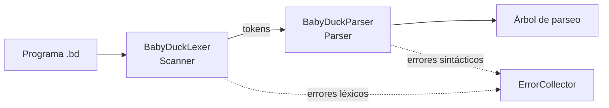

# Compilador BabyDuck

**Autor(a):** [Tu nombre] · **Matrícula:** [Tu matrícula]
**Materia:** [Nombre de la materia] · **Profesor(a):** [Nombre]

## Índice

1. [Overview](00_overview.md)
2. [Herramientas de generación](01_herramientas.md)
3. [Análisis Léxico](02_lexico.md)
4. [Análisis Sintáctico](03_sintaxis.md)
5. Análisis Semántico *(pendiente)*
6. Código Intermedio *(pendiente)*
7. Memoria Virtual *(pendiente)*
8. Máquina Virtual *(pendiente)*
9. [Testing](08_testing.md)
10. [Herramientas de IA](09_herramientas_ia.md)

---

## 0.1 Descripción

Este proyecto implementa un compilador para **BabyDuck**, un mini-lenguaje imperativo con variables enteras y flotantes, funciones con parámetros, condiciones, ciclos y entrada/salida.

El compilador se desarrolla en **Java** y usa **ANTLR4** para generar automáticamente el analizador léxico (Scanner) y el analizador sintáctico (Parser) a partir de un archivo de gramática.

## 0.2 Tecnologías

| Elemento | Versión / Herramienta |
|---|---|
| Lenguaje de desarrollo | Java 21 (LTS) |
| Generador de Scanner y Parser | ANTLR 4.13.2 |
| Gestor de proyecto y compilación | Maven |
| Pruebas automáticas | JUnit 5 |
| IDE | IntelliJ IDEA + plugin ANTLR v4 |

## 0.3 Flujo del compilador (estado actual)



## 0.4 Estructura del proyecto

```
compilador/
├── pom.xml                                  Configuración de Maven y ANTLR
├── docs/                                    Esta documentación
└── src/
    ├── main/
    │   ├── antlr4/com/babyduck/BabyDuck.g4  Gramática: tokens + reglas
    │   └── java/com/babyduck/
    │       ├── Main.java                    Punto de entrada
    │       ├── BabyDuckAnalyzer.java        Ejecuta lexer + parser
    │       └── ErrorCollector.java          Recolecta errores léxicos y sintácticos
    └── test/
        ├── java/com/babyduck/
        │   ├── LexerTest.java               Pruebas del Scanner
        │   └── ParserTest.java              Pruebas del Parser
        └── resources/syntax/
            ├── valid/                       Programas que deben aceptarse
            └── invalid/                     Programas que deben rechazarse
```

Las clases `BabyDuckLexer`, `BabyDuckParser`, `BabyDuckListener` y `BabyDuckVisitor` **no se escriben a mano**: el plugin de Maven las genera desde `BabyDuck.g4` en cada compilación, dentro de `target/generated-sources/antlr4/`.

## 0.5 Compilación y ejecución

```bash
mvn compile                 # genera el Scanner/Parser y compila
mvn test                    # ejecuta el Test-Plan (JUnit)
```

Para analizar un programa (en IntelliJ, como *Program arguments* de `Main`):

```
<archivo.bd> [--tokens]
```

- Sin `--tokens`: indica si el programa es válido e imprime el árbol de parseo, o lista los errores.
- Con `--tokens`: además imprime la lista de tokens reconocidos.

## 0.6 Avance por entrega

| Entrega | Contenido | Estado |
|---|---|---|
| 1 | Expresiones regulares, tokens y gramática libre de contexto (CFG) | ✅ |
| 2 | Selección de herramienta, Scanner, Parser y Test-Plan | ✅ |
| 3 | Análisis semántico | Pendiente |

---

## Navegación

- Siguiente: [Herramientas de generación →](01_herramientas.md)
